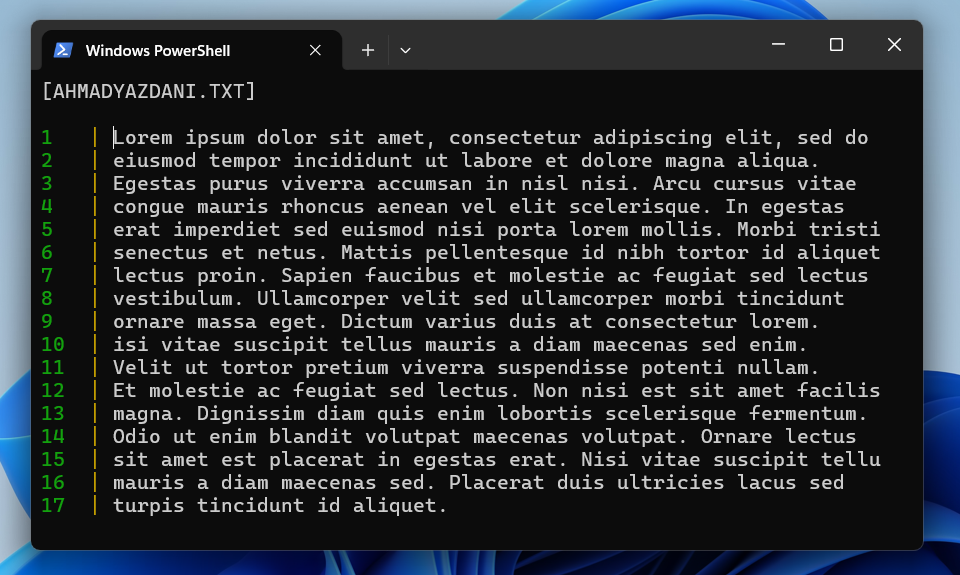
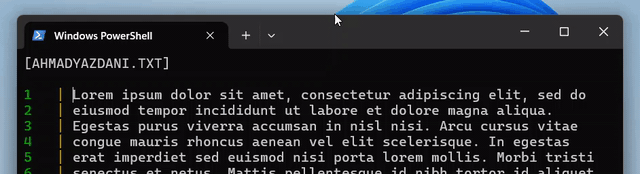
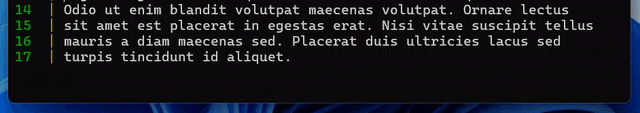

# Babriator

**A lightweight terminal-based text editor written in Go.**

Babriator is a command-line text editor inspired by tools such as `nano`. It provides essential text-editing features directly in the terminal, including cursor navigation, line editing, and keyboard shortcuts.

## ✨ Features

- **Cursor navigation:** Move through the document with the arrow keys.
- **Line editing:** Insert new lines with `Enter` and join lines by deleting backward at a line boundary.
- **Character editing:** Insert printable characters and use `Backspace` or `Delete` to remove characters.
- **Line navigation:** Jump to the beginning or end of the current line with `Home` and `End`.
- **Keyboard shortcuts:** Save with `Ctrl+S` or exit with `Ctrl+C`.
- **Terminal interface:** Uses raw terminal input and an alternate screen for an in-terminal editing experience.
<br/>

## 🖥️ Preview

Open a file in Babriator and edit its contents directly in the terminal.



<br/>
### Cursor navigation

Use the arrow keys to move the cursor around the document.



<br/>
### Editing lines

Use `Enter` to split a line, `Backspace` to delete backward or join lines, and `Home` / `End` to move to the beginning or end of a line.



<br/>
## 🚀 Getting started

<br/>
### Requirements

- [Go](https://go.dev/dl/) installed
- A terminal that supports ANSI escape sequences and raw input

<br/>
### Run from source

Clone the repository and enter the project directory:

```bash
git clone <repository-url>
cd <repository-directory>
```

Run Babriator with a file path:

```bash
go run . path/to/file.txt
```

If you run the program without a file-path argument, it prompts you to enter one:

```bash
go run .
```

<br/>
### Build

Build an executable for your current platform:

```bash
go build -o babriator .
```

Then launch it with a file path:

```bash
./babriator path/to/file.txt
```

On Windows, run the generated executable from PowerShell or Command Prompt:

```powershell
.\babriator.exe path\to\file.txt
```

<br/>
## ⌨️ Keyboard shortcuts

| Key | Action |
| --- | --- |
| `←` `↑` `→` `↓` | Move the cursor |
| `Home` | Move to the beginning of the current line |
| `End` | Move to the end of the current line |
| `Enter` | Split the current line |
| `Backspace` | Delete the previous character; at a line boundary, join with the previous line |
| `Delete` | Delete the character at the cursor |
| `Ctrl+S` | Save and exit |
| `Ctrl+C` | Exit without saving |
<br/>
<br/>
## 🧱 Project structure

```text
.
├── main.go
├── go.mod
├── go.sum
├── buffer/
│   ├── cursor.go
│   ├── cursorFunctionalities.go
│   ├── lineBufferEvent.go
│   ├── linesBuffer.go
│   ├── textLineFunctionalities.go
│   └── events/
│       ├── lineCreated.go
│       ├── lineRemoved.go
│       └── lineUpdated.go
├── helpers/
│   ├── filehelper.go
│   ├── keysHelper.go
│   └── stringsHelper.go
├── logging/
│   └── errorlogger.go
└── screen/
    ├── ansiSequences.go
    └── screen.go
```

- **`buffer/`** — Manages text lines, cursor position, editing operations, and line-change events.
- **`helpers/`** — Provides file, keyboard-input, and string helper functions.
- **`logging/`** — Contains error-logging functionality.
- **`screen/`** — Handles terminal screen behavior and rendering.

<br/>
## 🛠️ Built with

- [Go](https://go.dev/)
- [`golang.org/x/term`](https://pkg.go.dev/golang.org/x/term) for terminal input mode
- [`godotenv`](https://github.com/joho/godotenv) for environment configuration